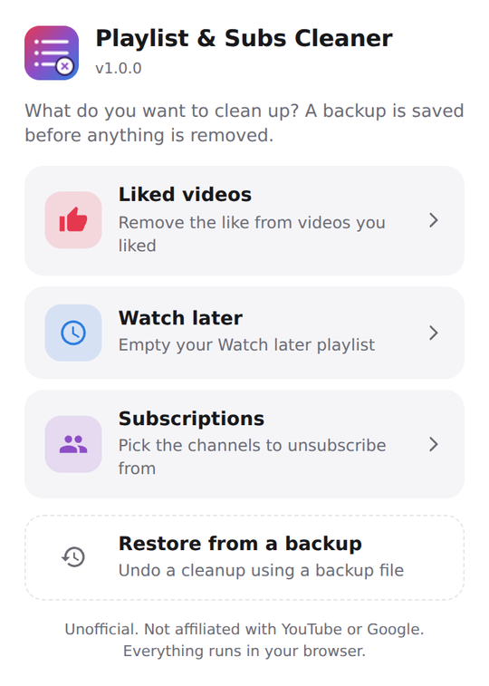
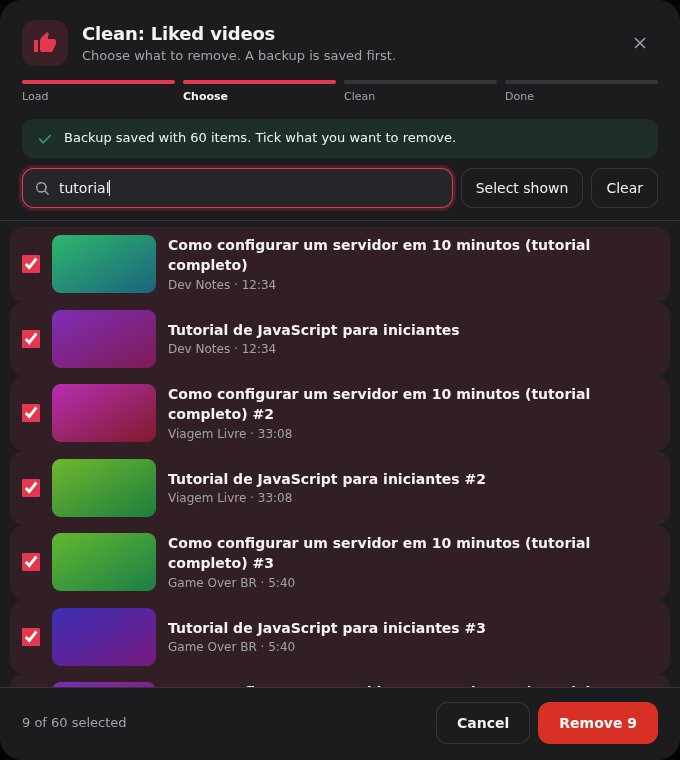

# Playlist & Subs Cleaner for YouTube

[English](README.md)

Uma extensão para navegadores (Microsoft Edge, Google Chrome e outros baseados em Chromium) para limpar a sua biblioteca do YouTube em poucos cliques:

- **Vídeos que gostei**: remova o like dos vídeos que escolher (ou de todos).
- **Ver mais tarde**: remova vídeos da sua playlist Ver mais tarde.
- **Inscrições**: escolha, um a um, de quais canais cancelar a inscrição.

Antes de remover qualquer coisa, um **backup** da lista inteira é salvo no seu computador, e você pode **restaurá-lo** depois com um clique.

Tudo roda no seu navegador, usando a sessão em que você já está logado. Sem chave de API, sem projeto no Google Cloud e sem servidores externos.

<p align="center">
  
  &nbsp;
  
</p>

> As imagens usam dados simulados.

## Recursos

- **Uma extensão, três limpezas**, com o mesmo fluxo simples: carregar, escolher, limpar, concluído.
- **Você escolhe o que sai.** Toda lista é uma lista de seleção com miniaturas ou avatares. Nada vem marcado por padrão. A busca por nome (ignora acentos e maiúsculas), *Marcar exibidos* e *Desmarcar* facilitam listas longas.
- **Etapa de confirmação** antes de remover, desfeita automaticamente se você mudar a seleção.
- **Backup automático** de *tudo* o que foi encontrado (não só do que você marcou), baixado como `.json` antes de a limpeza começar.
- **Restauração inteligente**: um único ponto de entrada para todos os backups. A extensão reconhece o que o arquivo contém e também lê os backups das versões anteriores deste projeto, que faziam uma coisa só.
- **Andamento** com porcentagem, tempo restante, botão Parar, desaceleração automática quando o YouTube limita as requisições e a lista dos itens que falharam.
- Temas **claro e escuro** (acompanha o do YouTube), **português (BR) e inglês**.

## Instalação (sem pacote)

1. Baixe ou clone este repositório.
2. Abra `edge://extensions` (Edge) ou `chrome://extensions` (Chrome).
3. Ative o **Modo do desenvolvedor**.
4. Clique em **Carregar sem pacote** e selecione a pasta do projeto (a que contém o `manifest.json`).
5. Fixe a extensão na barra de ferramentas.

Requer um navegador baseado em Chromium, versão 111 ou mais nova.

## Como usar

### Limpar algo

1. Clique no ícone da extensão e escolha **Vídeos que gostei**, **Ver mais tarde** ou **Inscrições**. Se você não estiver na página certa do YouTube, ela abre em uma nova aba e a limpeza começa sozinha.
2. A extensão rola a lista inteira e baixa o backup.
3. Marque o que quer remover. Use a busca para reduzir a lista.
4. Clique em **Remover N** e clique de novo para confirmar.
5. Ao terminar, recarregue a página para ver o resultado.

Dica: teste com dois ou três itens primeiro.

### Restaurar de um backup

1. Clique no ícone da extensão e escolha **Restaurar de um backup**.
2. Escolha (ou arraste) o arquivo `.json`. Tudo vem marcado; desmarque o que não quer de volta.
3. Clique em **Restaurar N**.

O que a restauração traz e o que não traz de volta:

| Backup de | Resultado |
| --- | --- |
| Vídeos que gostei | Os vídeos são curtidos de novo, do mais antigo ao mais novo, para recriar a ordem da lista. As datas originais dos likes não são recuperadas. |
| Ver mais tarde | Os vídeos são adicionados de volta, do último para o primeiro, para tentar manter a ordem. Onde eles ficam depende da ordenação da playlist. |
| Inscrições | Você se inscreve de novo. O sininho de notificações, a data original e qualquer agrupamento não são restaurados. |

### Formato do backup

```json
{
  "format": "youtube-library-cleaner-backup",
  "version": 1,
  "type": "likes",
  "exportedAt": "2026-10-09T12:00:00.000Z",
  "total": 1,
  "items": [
    { "id": "dQw4w9WgXcQ", "title": "Título do vídeo", "channel": "Canal", "duration": "3:33" }
  ]
}
```

O identificador `format` mantém o nome original do projeto para que os backups já existentes continuem funcionando. `type` é `likes`, `watchLater` ou `subscriptions` (os itens de inscrições têm `id`, `title`, `subtitle`, `url` e `avatar`). Arquivos das extensões anteriores também são aceitos, inclusive o primeiríssimo formato (um array simples de `{ "id", "titulo" }`); nesse caso a extensão pergunta se é um backup de Vídeos que gostei ou de Ver mais tarde.

## Como funciona

O popup pede a um service worker em segundo plano que abra a página certa e injete na aba os scripts de `src/page/`, no contexto JavaScript da própria página (necessário para ler o `window.ytcfg`). A janela que você vê é desenhada dentro de um Shadow DOM, então os estilos do YouTube não a afetam.

As ações usam os mesmos endpoints internos do cliente web do YouTube, autenticados com o cabeçalho padrão `SAPISIDHASH`, calculado a partir do cookie da sua própria sessão:

| Alvo | Endpoint | Ação |
| --- | --- | --- |
| Vídeos que gostei | `like/removelike` e `like/like` | por vídeo |
| Ver mais tarde | `browse/edit_playlist` | `ACTION_REMOVE_VIDEO_BY_VIDEO_ID`, `ACTION_ADD_VIDEO` na playlist `WL` |
| Inscrições | `subscription/unsubscribe` e `subscription/subscribe` | por canal |

A API oficial YouTube Data API não é uma boa opção: exige credenciais OAuth e um projeto no Google Cloud, cada chamada gasta cota e ela não permite mais que aplicativos modifiquem Ver mais tarde.

## Privacidade

- Nada é enviado para lugar nenhum além do `youtube.com`, direto do seu navegador.
- Sem analytics, sem telemetria, sem código remoto.
- As únicas permissões são `scripting` e acesso a `https://www.youtube.com/*`.
- Os backups são salvos apenas na pasta de downloads do seu computador.

## Limitações e aviso

- Este projeto é **não oficial** e não tem afiliação com o YouTube ou o Google.
- Ele lê listas das páginas do YouTube e usa **endpoints internos e não documentados**. Qualquer um dos dois pode mudar a qualquer momento e quebrar a extensão. Os testes automatizados usam uma página simulada e não detectam isso.
- Automatizar ações na sua conta pode contrariar os Termos de Serviço do YouTube. **Use por sua conta e risco.** As requisições são espaçadas de propósito (cerca de uma por segundo).
- **Mantenha a aba aberta e visível** enquanto roda. Os navegadores desaceleram muito as abas em segundo plano, o que pode deixar limpezas longas lentíssimas.
- **Listas grandes levam tempo.** A cerca de um item por segundo, 5.000 itens levam bem mais de uma hora. Se sobrar algo, rode de novo.
- **Os contadores podem demorar.** Depois da limpeza, o número no cabeçalho de uma playlist ou em outros lugares pode continuar o mesmo por algumas horas (cache do YouTube). Recarregue com `Ctrl+Shift+R` ou olhe de novo mais tarde.
- **Itens indisponíveis** (vídeos excluídos ou privados, canais encerrados) podem ficar ocultos na lista, não podem ser removidos por esta extensão e não podem ser restaurados.
- Remover só é reversível pela função de restaurar ou manualmente. Guarde o arquivo de backup.

## Solução de problemas

| Sintoma | O que fazer |
| --- | --- |
| Nada encontrado | Confira se está logado na conta certa e na página certa. |
| Falhas com status `400` ou `-3` | A API interna pode ter mudado. Abra uma issue com a saída do console (`F12`). |
| Status `401` / `403` | Sua sessão não é válida. Recarregue o YouTube e faça login de novo. |
| Status `429` | O YouTube está limitando as requisições. A extensão espera 60 s e tenta de novo sozinha. |
| Nada acontece ao clicar | Recarregue a aba do YouTube e tente de novo. |
| Várias contas Google | A extensão age na conta ativa na aba. Confira antes de confirmar. |

## Desenvolvimento

```bash
npm install
npm test
```

Os testes carregam os scripts reais da página em uma página simulada do YouTube (jsdom) e usam a janela como um usuário usaria. Cobrem o parser de backups, as três limpezas, o fluxo de restauração e o comportamento da janela.

```
manifest.json            Manifest V3
src/background.js        Abre a página certa e injeta os scripts
src/popup/               Popup da barra de ferramentas
src/page/i18n.js         Textos da janela (en / pt)
src/page/styles.js       Estilo da janela (Shadow DOM)
src/page/api.js          Chamadas autenticadas à API interna do YouTube
src/page/targets.js      Likes, Ver mais tarde e Inscrições: coletar e agir
src/page/backup.js       Formato de backup, parser e formatos antigos
src/page/ui.js           A janela (sem innerHTML: o YouTube exige Trusted Types)
src/page/main.js         Fluxos de limpar e restaurar
_locales/                Traduções do popup e do manifest
tests/smoke.test.js      Testes com página simulada
```

Para adicionar um idioma, inclua uma entrada em `src/page/i18n.js` e uma pasta em `_locales/`.

## Contribuindo

Issues e pull requests são bem-vindos, principalmente relatos de mudanças do YouTube que quebrem alguma limpeza.

## Licença

[MIT](LICENSE)
